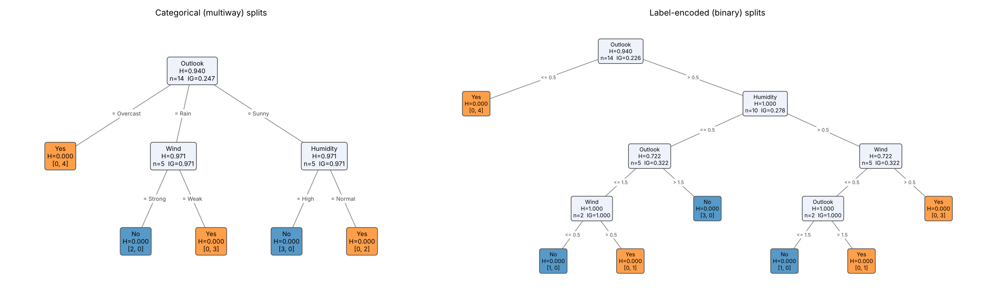

# gaintree

Classification tree that picks every split by **maximum information gain**, written with NumPy only and built to swallow messy real-world tables (missing values, text, dates, IDs, `inf`) without any preprocessing.

```bash
pip install gaintree            # numpy only
pip install "gaintree[draw]"    # + matplotlib for .draw()
```

## 30-second tour

```python
from gaintree import GainTreeClassifier, load_play_tennis

X, y, cols = load_play_tennis()
tree = GainTreeClassifier().fit(X, y, feature_names=cols)
print(tree.to_text())
tree.predict([["Rain", "Cool", "Normal", "Strong"]])   # array(['No'])
```

```
[Outlook]
├── Overcast ⇒ Yes  (4/4)
├── Rain ⇒ [Wind]
│   ├── Strong ⇒ No  (2/2)
│   └── Weak ⇒ Yes  (3/3)
└── Sunny ⇒ [Humidity]
    ├── High ⇒ No  (3/3)
    └── Normal ⇒ Yes  (2/2)
```

`(4/4)` = rows voting for the predicted class / rows in the leaf. `to_text(details=True)` adds entropy and gain; `draw()` gives a matplotlib figure; `to_dot()` gives Graphviz source.



## From the terminal

```bash
gaintree passengers.csv --target survived --max-depth 4 --plot tree.png
```

## Knobs

| Argument | Default | Meaning |
|---|---|---|
| `max_depth` | `None` | deepest level allowed (trunk = 0) |
| `min_samples_split` | `2` | smallest node that may still be split |
| `min_samples_leaf` | `1` | smallest branch a split may create |
| `min_gain` | `0.0` | splits must gain more than this many bits |
| `max_leaves` | `None` | grow best-gain-first until this many leaves |
| `categorical` | `"auto"` | text columns get one branch per category; `"none"` or a list to override |
| `skip_id_columns` | `True` | ignore text columns that are unique per row |

After fitting: `prune(X_val, y_val)`, `predict`, `predict_proba`, `score`, `apply`, `depth()`, `n_leaves()`, `n_nodes()`, `walk()`, `feature_importances_`, `ignored_features_`.

## What "messy" means here

Missing values (`None`, `NaN`, `pd.NA`, `NaT`) · numbers and ISO dates written as text · real dates and durations · booleans · `inf` · ID columns · constant columns · a single class · hundreds of classes · categories never seen in training · DataFrame columns shuffled at predict time · 100k+ rows · trees thousands of levels deep (no recursion). Input can be a list of rows, a NumPy array, a pandas or polars DataFrame, or a scipy sparse matrix.

## Tests and demos

```bash
pip install -e ".[test]"
pytest -q                          # 50 tests
python demos/play_tennis_demo.py   # course exercise, step by step
python demos/vs_sklearn.py         # 5-fold CV against scikit-learn
python demos/pruning_demo.py       # effect of reduced-error pruning
python demos/torture_test.py       # 7 very different datasets
```

MIT licence.
